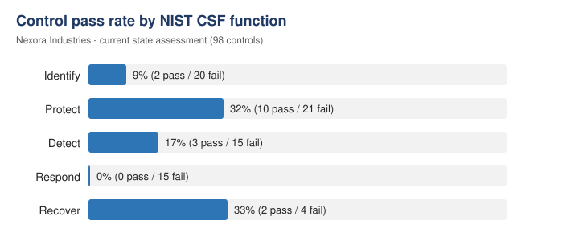

# NIST CSF Cyber Security Assessment & 3-Year Roadmap

**A GRC consulting case study: assessing a fictional company's security posture against the NIST Cybersecurity Framework (CSF) and designing a 3-year uplift program.**

> **Scenario:** Nexora Industries (fictional), a research-driven organisation running fully on Microsoft 365, Azure and SaaS, asked for a comprehensive cyber security program that
> 1. highlights the current deficiencies in its cyber security controls, and
> 2. defines a 3-year roadmap to uplift its cyber security posture.

---

## Deliverables

| File | Content |
|---|---|
| [`Nexora_NIST_CSF_Assessment.xlsx`](Nexora_NIST_CSF_Assessment.xlsx) | Full assessment: 98 NIST CSF controls across Identify, Protect, Detect, Respond and Recover, each with a result and an evidence-based finding, plus a summary sheet and the 3-year roadmap |
| This README | Executive summary, key findings, roadmap and approach |

## Approach

1. **Scoping:** Reviewed the current-state description of the organisation (team structure, governance, IAM, network, data, detection and response, BCP/DR, physical security).
2. **Control assessment:** Rated each NIST CSF subcategory as **Pass / Fail / N/A / To confirm**.
   - *Evidence-based:* a control only passes if the evidence shows it is in place. "Partially met" is rated **Fail**, with the partial strengths noted in the finding.
   - *N/A* only where a control truly does not apply (for example SDLC, since the organisation does no software development).
   - *To confirm* where information is missing and an assumption would be unsafe (for example critical-infrastructure status).
3. **Gap analysis:** Aggregated results per function to identify systemic weaknesses.
4. **Roadmap:** Grouped the gaps into initiatives and prioritised them by risk reduction, dependencies and effort across three years.

## Executive Summary

| NIST CSF Function | Pass | Fail | N/A | To confirm | Pass rate* |
|---|:-:|:-:|:-:|:-:|:-:|
| Identify | 2 | 20 | 0 | 2 | 9% |
| Protect | 10 | 21 | 4 | 0 | 32% |
| Detect | 3 | 15 | 0 | 0 | 17% |
| Respond | 0 | 15 | 0 | 0 | 0% |
| Recover | 2 | 4 | 0 | 0 | 33% |
| **Total** | **17** | **75** | **4** | **2** | **18%** |

* Pass rate = Pass / (Total − N/A − To confirm)

**Overall maturity is low.** Physical security, network security (NGFW, VLAN segmentation), endpoint baselining (SOE) and BCP/DR are solid foundations. Governance, cyber risk management, identity security, detection and incident response are largely missing.

### Key Deficiencies

- **Governance:** No cyber security strategy, no information security policy, and undefined cyber roles. Security reports to the IT manager, with no board oversight.
- **Risk management:** The risk function covers financial risk only. There is no cyber risk process, risk register or risk appetite.
- **Identity & access:** No MFA (including VPN), a shared admin password, no PAM, no user access reviews.
- **Vulnerability management:** The scanner is licensed but used ad hoc. There is a large backlog of high/severe vulnerabilities and no remediation SLAs.
- **Third-party risk:** No supplier inventory or security assessments (including the critical SaaS provider). Contracts lack security clauses.
- **Data security:** No data classification, labelling or DLP, and no removable-media controls.
- **Detection & response:** No SIEM, no SOC and no incident response plan. Only reactive antivirus alert handling.
- **Awareness:** Only a one-off induction module. No recurring training or phishing simulations.

### Strengths

Highly secure physical environment with 24/7 monitoring · extensive staff vetting · Palo Alto NGFWs, audited yearly · VLAN segmentation · up-to-date network diagrams including cloud · SOE images · documented and tested BCP/DR and backups.

## 3-Year Cyber Security Roadmap

### Year 1: Foundation (governance & quick wins)
| Initiative | Key activities | Priority |
|---|---|---|
| Cyber governance & leadership | Appoint a CISO / Head of Cyber reporting to the CEO, define a RACI, report to the board regularly | Critical |
| Cyber security strategy | 3-year strategy aligned with the business strategy, approved by the board | Critical |
| Policy framework | Information Security Policy plus standards (access control, data classification, vulnerability management, IR, TPRM, change management) | Critical |
| Identity quick wins | MFA for all users, Microsoft 365 and VPN; remove the shared admin password; named admin accounts; PAM | Critical |
| Vulnerability management program | Full scanner coverage, scan cadence, remediation SLAs by severity, backlog reduction, threat intel feeds | Critical |
| Cyber risk management | Extend the enterprise risk framework to cyber; risk register; board-approved risk appetite | High |
| Incident response plan | IR plan and playbooks (NIST SP 800-61 / SANS), escalation paths, tabletop exercise | High |
| Asset inventory / CMDB | Hardware, software and SaaS with owners, criticality and periodic review | High |

### Year 2: Build (detection & data protection)
| Initiative | Key activities | Priority |
|---|---|---|
| Security monitoring | SIEM (e.g. Microsoft Sentinel) plus a 24/7 MSSP/MDR; onboard identity, M365, endpoint, cloud and firewall logs | Critical |
| Data protection | Classification scheme, data discovery & labelling (e.g. Microsoft Purview), DLP, USB controls | High |
| Third-party risk management | Supplier tiering, pre-onboarding assessments, security and breach-notification clauses | High |
| Security awareness | Annual mandatory training, phishing simulations, role-based training for executives and admins | High |
| Access governance | Joiner-mover-leaver process, quarterly access reviews, least privilege | Medium |
| Change management | Documented change process with approvals | Medium |

### Year 3: Optimise (resilience & continuous improvement)
| Initiative | Key activities | Priority |
|---|---|---|
| Cyber resilience | Ransomware scenarios in BCP/DR, crisis communication & PR plan, lessons learned | High |
| Testing & assurance | Penetration tests, red/purple teaming, testing of detection use cases and IR plans | Medium |
| Zero Trust & device compliance | Conditional access with device compliance, control of unregistered devices | Medium |
| Continuous improvement | Cyber KPIs/KRIs for the board, ISAC membership, NIST CSF reassessment, ISO 27001 readiness | Medium |

**Prioritisation logic:** Governance comes first, because without a mandate, owner and policy, technical controls cannot be enforced or sustained. Low-cost, high-impact quick wins (MFA, removing shared admin credentials) are pulled into Year 1. Capabilities that depend on foundations, such as a SIEM needing defined assets, roles and IR processes, follow in Year 2.

## Skills Demonstrated

`NIST Cybersecurity Framework` · `Gap Analysis` · `Control Assessment` · `GRC` · `Cyber Risk Management` · `Security Roadmapping` · `Third-Party Risk Management` · `Identity & Access Management` · `Incident Response Planning` · `Executive Reporting`

---

Capstone project completed as part of the *GRC Mastery – Cyber Security Consulting* course. The company and scenario are fictional. Course materials (questionnaire, scenario documents, model solution) are not included in this repository.
